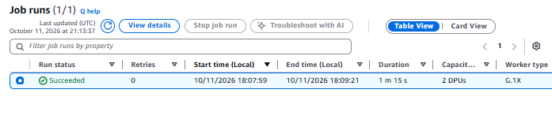

# Evidências — Lab Aula 06 (Spark SQL / DataFrames na AWS)

## Identificação

- **Nome:** Sirlande Martins de Oliveira Junior
- **RA:** 6325269
- **Branch:** aula-06-aws-6325269
- **Data:** 11/10/2026

---

## 1. Identidade AWS ativa

**Comando:**
```bash
aws sts get-caller-identity
```

Saída:
```text
{
    "UserId": "AROA************:user5367787=Sirlande_Martins_de_Oliveira_Junior_-_6325269",
    "Account": "3858****2318",
    "Arn": "arn:aws:sts::3858****2318:assumed-role/voclabs/user5367787=Sirlande_Martins_de_Oliveira_Junior_-_6325269"
}
```

---

## 2. `terraform apply` concluído

**Onde:** `cd aws-lab/infra && terraform apply`

Saída (trecho final):
```text
terraform_data.bucket (local-exec): upload: ../job/dataframe_job.py to s3://lab-aula06-glue-6325269/scripts/dataframe_job.py
terraform_data.bucket (local-exec): upload: ../data/pedidos.csv to s3://lab-aula06-glue-6325269/input/pedidos.csv
terraform_data.bucket (local-exec): upload: ../data/clientes.csv to s3://lab-aula06-glue-6325269/input/clientes.csv
terraform_data.bucket: Creation complete after 6s [id=4d2e4251-c29b-798f-0ea8-d69979446e06]
aws_glue_job.topn: Creating...
aws_glue_job.topn: Creation complete after 2s [id=job-aula06-topn-clientes]

Apply complete! Resources: 2 added, 0 changed, 0 destroyed.

Outputs:

bucket_nome = "lab-aula06-glue-6325269"
glue_job_nome = "job-aula06-topn-clientes"
labrole_arn = "arn:aws:iam::3858****2318:role/LabRole"
```

---

## 3. Job com estado SUCCEEDED (Glue)

**Onde:** `cd aws-lab/scripts && ./run_job.sh`

Saída:
```text
BUCKET   = lab-aula06-glue-6325269
GLUE_JOB = job-aula06-topn-clientes
ROLE_ARN = arn:aws:iam::3858****2318:role/LabRole
$ aws s3 rm s3://lab-aula06-glue-6325269/output/top_clientes --recursive
$ aws glue start-job-run --job-name job-aula06-topn-clientes ...
RUN_ID = jr_e1ff36963873114580bc04e3271e6b448ad08cb174d8b7473a5fdee1c5d244e9
Aguardando o job terminar (estados: STARTING -> RUNNING -> SUCCEEDED/FAILED)...
estado: RUNNING
estado: RUNNING
estado: RUNNING
estado: RUNNING
estado: RUNNING
estado: RUNNING
estado: SUCCEEDED
Job concluido com SUCESSO.
```

Detalhes do run (`aws glue get-job-run`): estado `SUCCEEDED`, tempo de execução
75 s (início 18:07:59, fim 18:09:21, horário de Brasília).

Print do console (AWS Glue → Jobs → `job-aula06-topn-clientes` → Runs):



---

## 4. Resultado do TOP-N de clientes

**Onde:** `cd aws-lab/scripts && ./ver_resultado.sh`

Saída:
```text
BUCKET = lab-aula06-glue-6325269
$ aws s3 ls s3://lab-aula06-glue-6325269/output/top_clientes/
2026-10-11 18:09:11        189 part-00000-b5bcf66f-016a-41b9-9139-ab4e3a08339f-c000.csv
=== Top clientes por gasto (customer_id,customer_name,total_spend) ===
customer_id,customer_name,total_spend
C009,Isabela Nunes,12928.099999999999
C004,Diego Ferreira,9862.4
C001,Ana Souza,3612.0900000000006
C007,Gabriela Lima,2739.0
C002,Bruno Almeida,2721.4
```

---

## 5. Interpretação do TOP-N

Top-N:
```text
customer_id,customer_name,total_spend
C009,Isabela Nunes,12928.10
C004,Diego Ferreira,9862.40
C001,Ana Souza,3612.09
C007,Gabriela Lima,2739.00
C002,Bruno Almeida,2721.40
```

Interpretação:

> O gasto está bem concentrado: Isabela Nunes (C009) e Diego Ferreira (C004) somam
> cerca de R$ 22,8 mil, cerca de 2,5 vezes o que os outros três clientes do top 5
> gastaram juntos (R$ 9,1 mil).
> Isso acompanha a receita por categoria, em que `eletronicos` (R$ 32,9 mil) domina.
> Para chegar nesse ranking, o Spark faz o **join** de `pedidos` com `clientes` por
> `customer_id` (para trazer o nome), aplica **groupBy + `F.sum("value")`** por
> cliente e ordena com `limit(5)`, tudo na API de **DataFrames**. No Glue, o
> **driver** monta o plano e coordena as etapas, enquanto os **executors** processam
> as partições do join e da agregação parcial antes do shuffle que consolida as
> somas por cliente.

---

## 6. Logs do driver (opcional / bônus)

Trecho do log do driver no CloudWatch (grupo `/aws-glue/jobs/output`, stream do
run `jr_e1ff3696...`), com os `print(...)` do `dataframe_job.py`:

```text
|C004       |Diego Ferreira|9862.4            |
|C001       |Ana Souza     |3612.0900000000006|
|C007       |Gabriela Lima |2739.0            |
|C002       |Bruno Almeida |2721.4            |
+-----------+--------------+------------------+

C009,Isabela Nunes,12928.099999999999
C004,Diego Ferreira,9862.4
C001,Ana Souza,3612.0900000000006
C007,Gabriela Lima,2739.0
C002,Bruno Almeida,2721.4

Resultado gravado em: s3://lab-aula06-glue-6325269/output/top_clientes
```

---

## 7. Limpeza (`terraform destroy`)

**Onde:** `cd aws-lab/infra && terraform destroy`

Saída:
```text
aws_glue_job.topn: Destruction complete after 1s
terraform_data.bucket: Destroying... [id=4d2e4251-c29b-798f-0ea8-d69979446e06]
terraform_data.bucket (local-exec): Executing: ["/bin/sh" "-c" "aws s3 rb s3://lab-aula06-glue-6325269 --force || true"]
terraform_data.bucket (local-exec): delete: s3://lab-aula06-glue-6325269/scripts/dataframe_job.py
terraform_data.bucket (local-exec): delete: s3://lab-aula06-glue-6325269/output/top_clientes/part-00000-b5bcf66f-016a-41b9-9139-ab4e3a08339f-c000.csv
terraform_data.bucket (local-exec): delete: s3://lab-aula06-glue-6325269/input/clientes.csv
terraform_data.bucket (local-exec): delete: s3://lab-aula06-glue-6325269/input/pedidos.csv
terraform_data.bucket (local-exec): remove_bucket: lab-aula06-glue-6325269
terraform_data.bucket: Destruction complete after 2s

Destroy complete! Resources: 2 destroyed.
```

Conferência pós-destroy:
```text
$ aws s3 ls s3://lab-aula06-glue-6325269
An error occurred (NoSuchBucket) ... The specified bucket does not exist
$ aws glue get-job --job-name job-aula06-topn-clientes
An error occurred (EntityNotFoundException) ... Job not found.
```

---

## Checklist de conferência

- [x] 1. Identidade AWS ativa (`aws sts get-caller-identity`)
- [x] 2. `terraform apply` concluído ("Apply complete!" + outputs)
- [x] 3. Job com estado `SUCCEEDED` (Glue) (+ `JobRunId`)
- [x] 4. Resultado do TOP-N de clientes (`./ver_resultado.sh`)
- [x] 5. Interpretação do TOP-N (2–3 frases)
- [x] 6. Logs do driver (opcional / bônus)
- [x] 7. Limpeza com `terraform destroy` ("Destroy complete!")
