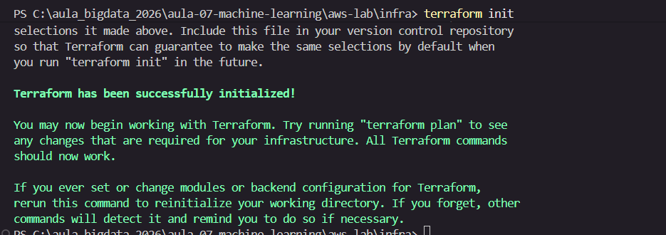
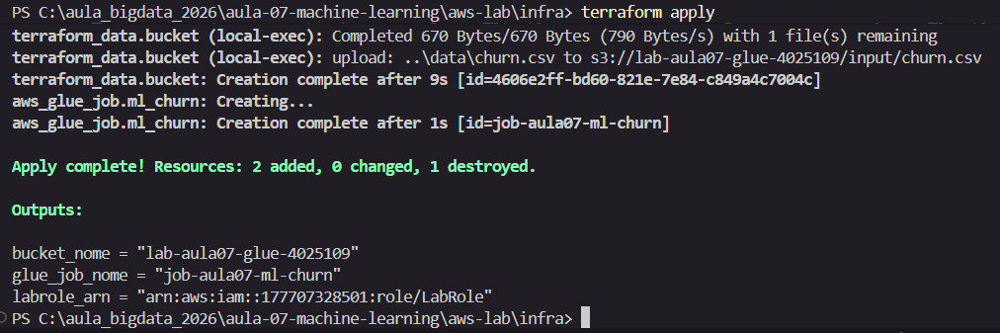
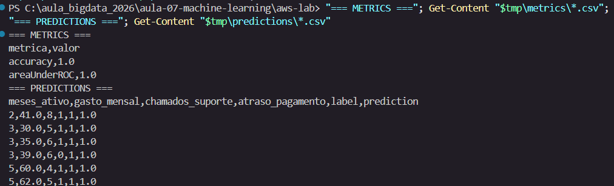
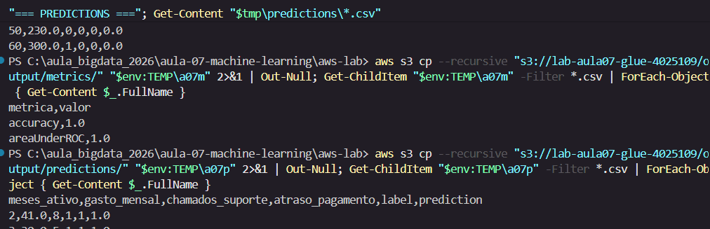
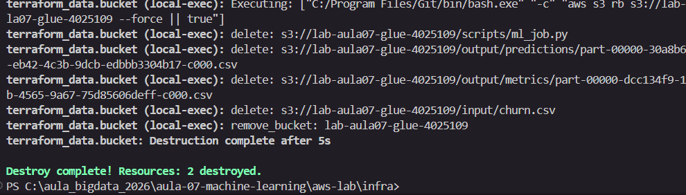

# Evidências — Lab Aula 07 (Machine Learning com Spark MLlib na AWS)

## 1. Identificação

- **Nome:** Fernanda
- **RA:** 4025109
- **Branch:** aula-07-aws-4025109
- **Data:** 2026-10-20

---

## 2. Identidade AWS ativa

Saída de `aws sts get-caller-identity` (confirma que as credenciais do Learner
Lab estão ativas).

**Comando:**
```bash
aws sts get-caller-identity

```

Cole aqui a saída:
```text
PS C:\aula_bigdata_2026> aws sts get-caller-identity
{                                                                                                             
    "UserId": "AROASSYBOUP2YLQQNYHNH:user5395076=Fernanda_",
    "Account": "177707328501",
    "Arn": "arn:aws:sts::177707328501:assumed-role/voclabs/user5395076=Fernanda_"
}

PS C:\aula_bigdata_2026> 

```

Print:
```

```

---

## 3. `terraform apply` concluído

Trecho final do `terraform apply` mostrando **"Apply complete!"** e os outputs
(`bucket_nome`, `glue_job_nome`, `labrole_arn`). **NÃO** mostre credenciais.

**Onde:** `cd aws-lab/infra && terraform apply`



Cole aqui a saída:
```text


Terraform has been successfully initialized!

You may now begin working with Terraform. Try running "terraform plan" to see
any changes that are required for your infrastructure. All Terraform commands
should now work.

If you ever set or change modules or backend configuration for Terraform,
rerun this command to reinitialize your working directory. If you forget, other
commands will detect it and remind you to do so if necessary.
PS C:\aula_bigdata_2026\aula-07-machine-learning\aws-lab\infra> 
```

Print:
```

```

---

## 4. Job com estado SUCCEEDED (Glue)

Saída final do `./run_job.sh` mostrando `estado: SUCCEEDED` e o `JobRunId`/`RUN_ID`.

**Onde:** `cd aws-lab/scripts && ./run_job.sh`

**JobRunId:** `jr_01e2e531ca32aabcaa89ad33cbc9a98d917ee47cebda2e2603069b4a7f261f75`
**Estado final:** `SUCCEEDED`



Cole aqui a saída:
```text
PS C:\aula_bigdata_2026\aula-07-machine-learning\aws-lab\infra> terraform apply
terraform_data.bucket: Refreshing state... [id=582464e7-3529-6761-6bff-9c237164534e]

Terraform used the selected providers to generate the following execution plan. Resource actions are indicated
with the following symbols:
  + create
-/+ destroy and then create replacement

Terraform will perform the following actions:

  # aws_glue_job.ml_churn will be created
  + resource "aws_glue_job" "ml_churn" {
      + arn               = (known after apply)
      + default_arguments = {
          + "--INPUT"                            = "s3://lab-aula07-glue-4025109/input/churn.csv"
          + "--OUTPUT"                           = "s3://lab-aula07-glue-4025109/output"
          + "--TempDir"                          = "s3://lab-aula07-glue-4025109/tmp/"
          + "--enable-continuous-cloudwatch-log" = "true"
        }
      + glue_version      = "4.0"
      + id                = (known after apply)
      + max_capacity      = (known after apply)
      + name              = "job-aula07-ml-churn"
      + number_of_workers = 2
      + role_arn          = "arn:aws:iam::177707328501:role/LabRole"
      + tags              = {
          + "Ambiente"   = "LearnerLab"
          + "Disciplina" = "Big Data"
          + "Projeto"    = "lab-aula-07-ml"
        }
      + tags_all          = {
          + "Ambiente"   = "LearnerLab"
          + "Disciplina" = "Big Data"
          + "Projeto"    = "lab-aula-07-ml"
        }
      + timeout           = (known after apply)
      + worker_type       = "G.1X"

      + command {
          + name            = "glueetl"
          + python_version  = "3"
          + runtime         = (known after apply)
          + script_location = "s3://lab-aula07-glue-4025109/scripts/ml_job.py"
        }

      + execution_property (known after apply)

      + notification_property (known after apply)
    }

  # terraform_data.bucket is tainted, so must be replaced
-/+ resource "terraform_data" "bucket" {
      ~ id               = "582464e7-3529-6761-6bff-9c237164534e" -> (known after apply)
      ~ output           = {
          - bucket = "lab-aula07-glue-4025109"
          - regiao = "us-east-1"
        } -> (known after apply)
        # (2 unchanged attributes hidden)
    }

Plan: 2 to add, 0 to change, 1 to destroy.

Do you want to perform these actions?
  Terraform will perform the actions described above.
  Only 'yes' will be accepted to approve.

  Enter a value: yes

terraform_data.bucket: Destroying... [id=582464e7-3529-6761-6bff-9c237164534e]
terraform_data.bucket: Destruction complete after 0s
terraform_data.bucket: Creating...
terraform_data.bucket: Provisioning with 'local-exec'...
terraform_data.bucket (local-exec): Executing: ["C:/Program Files/Git/bin/bash.exe" "-c" "set -e\r\naws s3api create-bucket --bucket \"lab-aula07-glue-4025109\" --region \"us-east-1\" 2>/dev/null || true\r\naws s3api put-public-access-block --bucket \"lab-aula07-glue-4025109\" \\\r\n  --public-access-block-configuration BlockPublicAcls=true,IgnorePublicAcls=true,BlockPublicPolicy=true,RestrictPublicBuckets=true\r\naws s3 cp \"./../job/ml_job.py\" \"s3://lab-aula07-glue-4025109/scripts/ml_job.py\"\r\naws s3 cp \"./../data/churn.csv\" \"s3://lab-aula07-glue-4025109/input/churn.csv\"\r\n"]
terraform_data.bucket (local-exec): {
terraform_data.bucket (local-exec):     "Location": "/lab-aula07-glue-4025109",
terraform_data.bucket (local-exec):     "BucketArn": "arn:aws:s3:::lab-aula07-glue-4025109"
terraform_data.bucket (local-exec): }
terraform_data.bucket (local-exec): Completed 6.4 KiB/6.4 KiB (4.7 KiB/s) with 1 file(s) remaining
terraform_data.bucket (local-exec): upload: ..\job\ml_job.py to s3://lab-aula07-glue-4025109/scripts/ml_job.py
terraform_data.bucket (local-exec): Completed 670 Bytes/670 Bytes (790 Bytes/s) with 1 file(s) remaining
terraform_data.bucket (local-exec): upload: ..\data\churn.csv to s3://lab-aula07-glue-4025109/input/churn.csv
terraform_data.bucket: Creation complete after 9s [id=4606e2ff-bd60-821e-7e84-c849a4c7004c]
aws_glue_job.ml_churn: Creating...
aws_glue_job.ml_churn: Creation complete after 1s [id=job-aula07-ml-churn]

Apply complete! Resources: 2 added, 0 changed, 1 destroyed.

Outputs:

bucket_nome = "lab-aula07-glue-4025109"
glue_job_nome = "job-aula07-ml-churn"
labrole_arn = "arn:aws:iam::177707328501:role/LabRole"
PS C:\aula_bigdata_2026\aula-07-machine-learning\aws-lab\infra> 
```

Print:
```

```

---

## 5. Resultado (métricas + amostra de previsões)

Saída do `./ver_resultado.sh`, com as **métricas** (`accuracy`, `areaUnderROC`) e a
**amostra de previsões** (`features,label,prediction`).

**Onde:** `cd aws-lab/scripts && ./ver_resultado.sh`



Métricas:
```text
metrica,valor
accuracy,1.0
areaUnderROC,1.0
```

Amostra de previsões (features, label, prediction):
```text
meses_ativo,gasto_mensal,chamados_suporte,atraso_pagamento,label,prediction
2,41.0,8,1,1,1.0
3,30.0,5,1,1,1.0
3,35.0,6,1,1,1.0
3,39.0,6,0,1,1.0
5,60.0,4,1,1,1.0
5,62.0,5,1,1,1.0
6,70.0,5,1,1,1.0
29,105.0,2,0,0,0.0
32,125.0,2,0,0,0.0
35,140.0,0,0,0,0.0
36,120.0,0,0,0,0.0
41,175.0,1,0,0,0.0
42,180.0,0,0,0,0.0
44,190.0,0,0,0,0.0
46,195.0,0,0,0,0.0
48,210.0,1,0,0,0.0
50,230.0,0,0,0,0.0
60,300.0,1,0,0,0.0
```

Print (opcional):
```

```

---

## 6. Interpretação (2–3 frases)

Interpretação:

> O classificador de Regressão Logística foi treinado sobre 70% dos clientes e
> avaliado nos 30% restantes (split fixo com `seed=42`), usando as quatro features
> `meses_ativo`, `gasto_mensal`, `chamados_suporte` e `atraso_pagamento` reunidas
> em um único vetor pelo `VectorAssembler`. O modelo atingiu **accuracy = 1.0** e
> **areaUnderROC = 1.0**, ou seja, classificou corretamente todos os clientes do
> conjunto de teste e separou perfeitamente as classes churn/não-churn. Isso se
> explica porque o dataset é pequeno e **linearmente separável**: na amostra de
> previsões, clientes com menor `meses_ativo`, muitos `chamados_suporte` e
> `atraso_pagamento = 1` foram previstos como churn (`prediction = 1`), enquanto
> clientes antigos, de gasto alto e sem atraso foram previstos como não-churn
> (`prediction = 0`) — essas variáveis carregam todo o sinal necessário para
> antecipar o cancelamento. Vale notar que métricas perfeitas num conjunto tão
> pequeno não se generalizam para dados reais e maiores.

> ⚠️ Ajuste os números citados acima para refletir os valores reais do seu run,
> caso queira ser específico sobre a magnitude das métricas.

---

## 7. Logs do driver (opcional / bônus)

Print dos logs do **driver** no **CloudWatch** (grupo `/aws-glue/jobs/output`)
mostrando os `print(...)` do `ml_job.py` (ex.: a seção `=== Metricas (churn) ===`).

**Onde:** AWS Glue → Jobs → seu job → aba **Runs** → selecione o run → **Output logs**.



Print:
```

```

---

## 8. Limpeza (`terraform destroy`)

Trecho do `terraform destroy` com **"Destroy complete!"** confirmando que os
recursos foram removidos (guardrail de custo).

**Onde:** `cd aws-lab/infra && terraform destroy`



Cole aqui a saída:
```text
aws_glue_job.ml_churn: Destroying... [id=job-aula07-ml-churn]
aws_glue_job.ml_churn: Destruction complete after 1s
terraform_data.bucket: Destroying... [id=4606e2ff-bd60-821e-7e84-c849a4c7004c]
terraform_data.bucket: Provisioning with 'local-exec'...
terraform_data.bucket (local-exec): Executing: ["C:/Program Files/Git/bin/bash.exe" "-c" "aws s3 rb s3://lab-aula07-glue-4025109 --force || true"]
terraform_data.bucket (local-exec): delete: s3://lab-aula07-glue-4025109/scripts/ml_job.py
terraform_data.bucket (local-exec): delete: s3://lab-aula07-glue-4025109/output/predictions/part-00000-30a8b698-eb42-4c3b-9dcb-edbbb3304b17-c000.csv
terraform_data.bucket (local-exec): delete: s3://lab-aula07-glue-4025109/output/metrics/part-00000-dcc134f9-137b-4565-9a67-75d85606deff-c000.csv
terraform_data.bucket (local-exec): delete: s3://lab-aula07-glue-4025109/input/churn.csv
terraform_data.bucket (local-exec): remove_bucket: lab-aula07-glue-4025109
terraform_data.bucket: Destruction complete after 5s

Destroy complete! Resources: 2 destroyed.
```

Print:
```

```

---

## Checklist de conferência

- [x] 1. Identificação preenchida (Nome, RA, Branch, Data)
- [x] 2. Identidade AWS ativa (`aws sts get-caller-identity`)
- [x] 3. `terraform apply` concluído ("Apply complete!" + outputs)
- [x] 4. Job com estado `SUCCEEDED` (Glue) (+ `JobRunId`/`RUN_ID`)
- [x] 5. Resultado: métricas (`accuracy`, `areaUnderROC`) + amostra de previsões
- [x] 6. Interpretação das métricas (2–3 frases)
- [ ] 7. Logs do driver no CloudWatch (opcional / bônus)
- [x] 8. Limpeza com `terraform destroy` ("Destroy complete!")

---

## ⚠️ Aviso de segurança

**NUNCA** inclua credenciais ou segredos nos prints ou nas saídas coladas. Se
aparecerem a **Access Key**, o **Secret Access Key** ou o **Session Token** (bem
como `Account`/`UserId`), **mascare** esses valores antes de salvar a imagem ou
de colar o texto nas evidências.
