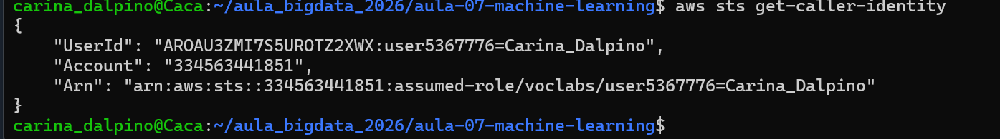
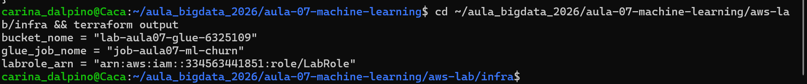
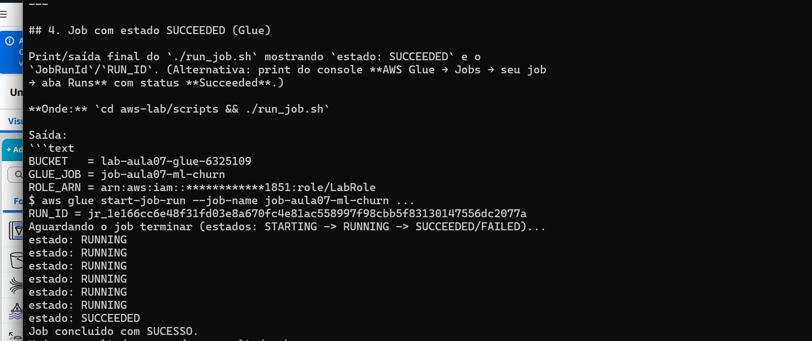

# Evidências — Lab Aula 07 (Machine Learning com Spark MLlib na AWS)

## 1. Identificação

- **Nome:** Carina Dalpino
- **RA:** 6325109
- **Branch:** aula-07-6325109
- **Data:** 14/10/2026

---

## 2. Identidade AWS ativa

Saída de `aws sts get-caller-identity` (confirma que as credenciais do Learner
Lab estão ativas). Pode mascarar o `Account`/`UserId`.

**Comando:**
```bash
aws sts get-caller-identity
```

Saída:
```text
{
    "UserId": "AROAU3ZMI7S5************:user5367776=Carina_Dalpino",
    "Account": "************1851",
    "Arn": "arn:aws:sts::************1851:assumed-role/voclabs/user5367776=Carina_Dalpino"
}
```

Print:
```

```

---

## 3. `terraform apply` concluído

Print ou trecho final do `terraform apply` mostrando **"Apply complete!"** e os
outputs (`bucket_nome`, `glue_job_nome`, `labrole_arn`). **NÃO** mostre credenciais.

**Onde:** `cd aws-lab/infra && terraform apply`

Saída:
```text
terraform_data.bucket: Creating...
terraform_data.bucket: Provisioning with 'local-exec'...
terraform_data.bucket (local-exec): {
terraform_data.bucket (local-exec):     "Location": "/lab-aula07-glue-6325109",
terraform_data.bucket (local-exec):     "BucketArn": "arn:aws:s3:::lab-aula07-glue-6325109"
terraform_data.bucket (local-exec): }
terraform_data.bucket (local-exec): upload: ../job/ml_job.py to s3://lab-aula07-glue-6325109/scripts/ml_job.py
terraform_data.bucket (local-exec): upload: ../data/churn.csv to s3://lab-aula07-glue-6325109/input/churn.csv
terraform_data.bucket: Creation complete after 7s
aws_glue_job.ml_churn: Creating...
aws_glue_job.ml_churn: Creation complete after 2s [id=job-aula07-ml-churn]

Apply complete! Resources: 2 added, 0 changed, 0 destroyed.

Outputs:
bucket_nome   = "lab-aula07-glue-6325109"
glue_job_nome = "job-aula07-ml-churn"
labrole_arn   = "arn:aws:iam::************1851:role/LabRole"
```

Print:
```

```

---

## 4. Job com estado SUCCEEDED (Glue)

Print/saída final do `./run_job.sh` mostrando `estado: SUCCEEDED` e o
`JobRunId`/`RUN_ID`. (Alternativa: print do console **AWS Glue → Jobs → seu job
→ aba Runs** com status **Succeeded**.)

**Onde:** `cd aws-lab/scripts && ./run_job.sh`

Saída:
```text
BUCKET   = lab-aula07-glue-6325109
GLUE_JOB = job-aula07-ml-churn
ROLE_ARN = arn:aws:iam::************1851:role/LabRole
$ aws glue start-job-run --job-name job-aula07-ml-churn ...
RUN_ID = jr_1e166cc6e48f31fd03e8a670fc4e81ac558997f98cbb5f83130147556dc2077a
Aguardando o job terminar (estados: STARTING -> RUNNING -> SUCCEEDED/FAILED)...
estado: RUNNING
estado: RUNNING
estado: RUNNING
estado: RUNNING
estado: RUNNING
estado: RUNNING
estado: SUCCEEDED
Job concluido com SUCESSO.
Veja o resultado com: ./ver_resultado.sh
```

Print:
```

```

---

## 5. Resultado (métricas + amostra de previsões)

Saída do `./ver_resultado.sh`, mostrando as **métricas** (`accuracy`,
`areaUnderROC`) e a **amostra de previsões** (`features,label,prediction`).

**Onde:** `cd aws-lab/scripts && ./ver_resultado.sh`

Métricas:
```text
metrica,valor
accuracy,1.0
areaUnderROC,1.0
```

Amostra de previsões (features, label, prediction):
```text
meses_ativo,gasto_mensal,chamados_suporte,atraso_pagamento,label,prediction
2,41.0,8,1,1,1.0
3,30.0,5,1,1,1.0
3,35.0,6,1,1,1.0
3,39.0,6,0,1,1.0
5,60.0,4,1,1,1.0
5,62.0,5,1,1,1.0
6,70.0,5,1,1,1.0
29,105.0,2,0,0,0.0
32,125.0,2,0,0,0.0
35,140.0,0,0,0,0.0
36,120.0,0,0,0,0.0
41,175.0,1,0,0,0.0
42,180.0,0,0,0,0.0
44,190.0,0,0,0,0.0
46,195.0,0,0,0,0.0
48,210.0,1,0,0,0.0
50,230.0,0,0,0,0.0
60,300.0,1,0,0,0.0
```

> Evidência registrada pela saída de texto acima (métricas + amostra de previsões
> do `./ver_resultado.sh`).

---

## 6. Interpretação (2–3 frases)

> O modelo de LogisticRegression atingiu `accuracy = 1.0` e `areaUnderROC = 1.0`
> no conjunto de teste (divisão treino/teste 70/30 com `seed=42`), acertando
> todas as previsões da amostra. Isso indica que, neste dataset, o churn é
> praticamente separável de forma linear a partir das features: clientes com
> poucos `meses_ativo`, muitos `chamados_suporte` e `atraso_pagamento` tendem a
> cancelar (label 1), enquanto clientes com mais tempo de casa e maior
> `gasto_mensal` tendem a permanecer (label 0). Vale notar que a acurácia
> perfeita se deve ao dataset ser pequeno e didaticamente bem separado — em dados
> reais, com mais ruído e sobreposição entre as classes, essas métricas seriam
> naturalmente menores.

---

## 7. Logs do driver (opcional / bônus)

Print dos logs do **driver** no **CloudWatch** (grupo `/aws-glue/jobs/output`)
mostrando os `print(...)` do `ml_job.py` (ex.: a seção `=== Metricas (churn) ===`).

**Onde:** AWS Glue → Jobs → seu job → aba **Runs** → selecione o run → **Output logs**.

Trecho do log do driver (grupo `/aws-glue/jobs/output`, stream do `RUN_ID`):
```text
=== Metricas (churn) ===
accuracy,1.0000
areaUnderROC,1.0000
Resultado gravado em: s3://lab-aula07-glue-6325109/output/metrics e s3://lab-aula07-glue-6325109/output/predictions
```

> Evidência registrada pela saída de texto acima (log do driver no CloudWatch,
> grupo `/aws-glue/jobs/output`).

---

## 8. Limpeza (`terraform destroy`)

Print/trecho do `terraform destroy` com **"Destroy complete!"** confirmando que os
recursos foram removidos (guardrail de custo).

**Onde:** `cd aws-lab/infra && terraform destroy`

Saída:
```text
Plan: 0 to add, 0 to change, 2 to destroy.
aws_glue_job.ml_churn: Destroying... [id=job-aula07-ml-churn]
aws_glue_job.ml_churn: Destruction complete after 1s
terraform_data.bucket: Destroying...
terraform_data.bucket (local-exec): delete: s3://lab-aula07-glue-6325109/input/churn.csv
terraform_data.bucket (local-exec): delete: s3://lab-aula07-glue-6325109/output/predictions/part-00000-...csv
terraform_data.bucket (local-exec): delete: s3://lab-aula07-glue-6325109/output/metrics/part-00000-...csv
terraform_data.bucket (local-exec): delete: s3://lab-aula07-glue-6325109/scripts/ml_job.py
terraform_data.bucket (local-exec): remove_bucket: lab-aula07-glue-6325109
terraform_data.bucket: Destruction complete after 4s

Destroy complete! Resources: 2 destroyed.
```

> Evidência registrada pela saída de texto acima (`terraform destroy` com
> "Destroy complete!").

---

## Checklist de conferência

- [x] 1. Identificação preenchida (Nome, RA, Branch, Data)
- [x] 2. Identidade AWS ativa (`aws sts get-caller-identity`)
- [x] 3. `terraform apply` concluído ("Apply complete!" + outputs)
- [x] 4. Job com estado `SUCCEEDED` (Glue) (+ `JobRunId`/`RUN_ID`)
- [x] 5. Resultado: métricas (`accuracy`, `areaUnderROC`) + amostra de previsões
- [x] 6. Interpretação das métricas (2–3 frases)
- [x] 7. Logs do driver no CloudWatch (opcional / bônus)
- [x] 8. Limpeza com `terraform destroy` ("Destroy complete!")

> Observação: as saídas de texto de cada etapa estão coladas acima. Prints de
> tela anexados nesta pasta: `01-identity.png`, `02-apply.png` e
> `03-job-success.png`. As demais etapas (resultado, logs do driver e destroy)
> estão comprovadas pelas saídas de texto reproduzidas acima.

---

## ⚠️ Aviso de segurança

**NUNCA** inclua credenciais ou segredos nos prints ou nas saídas coladas. Se
aparecerem a **Access Key**, o **Secret Access Key** ou o **Session Token**
(bem como `Account`/`UserId`), **mascare** esses valores antes de salvar a
imagem ou de colar o texto nas evidências.


  