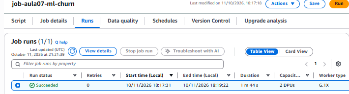

# Evidências — Lab Aula 07 (Machine Learning com Spark MLlib na AWS)

## 1. Identificação

- **Nome:** Sirlande Martins de Oliveira Junior
- **RA:** 6325269
- **Branch:** aula-07-aws-6325269
- **Data:** 11/10/2026

---

## 2. Identidade AWS ativa

**Comando:**
```bash
aws sts get-caller-identity
```

Saída (`Account`/`UserId` mascarados):
```text
{
    "UserId": "AROA************:user5367787=Sirlande_Martins_de_Oliveira_Junior_-_6325269",
    "Account": "3858****2318",
    "Arn": "arn:aws:sts::3858****2318:assumed-role/voclabs/user5367787=Sirlande_Martins_de_Oliveira_Junior_-_6325269"
}
```

---

## 3. `terraform apply` concluído

**Onde:** `cd aws-lab/infra && terraform apply`

Saída (trecho final):
```text
terraform_data.bucket (local-exec): upload: ../job/ml_job.py to s3://lab-aula07-glue-6325269/scripts/ml_job.py
terraform_data.bucket (local-exec): upload: ../data/churn.csv to s3://lab-aula07-glue-6325269/input/churn.csv
terraform_data.bucket: Creation complete after 5s [id=7726e336-b2c1-b8c2-0acd-a42b773c3d0e]
aws_glue_job.ml_churn: Creating...
aws_glue_job.ml_churn: Creation complete after 2s [id=job-aula07-ml-churn]

Apply complete! Resources: 2 added, 0 changed, 0 destroyed.

Outputs:

bucket_nome = "lab-aula07-glue-6325269"
glue_job_nome = "job-aula07-ml-churn"
labrole_arn = "arn:aws:iam::3858****2318:role/LabRole"
```

---

## 4. Job com estado SUCCEEDED (Glue)

**Onde:** `cd aws-lab/scripts && ./run_job.sh`

Saída:
```text
BUCKET   = lab-aula07-glue-6325269
GLUE_JOB = job-aula07-ml-churn
ROLE_ARN = arn:aws:iam::3858****2318:role/LabRole
$ aws s3 rm s3://lab-aula07-glue-6325269/output --recursive
$ aws glue start-job-run --job-name job-aula07-ml-churn ...
RUN_ID = jr_d34929d33ed846660a4bd808855c4863b2562526fc22d608b3a536c83db3d134
Aguardando o job terminar (estados: STARTING -> RUNNING -> SUCCEEDED/FAILED)...
estado: RUNNING
estado: RUNNING
estado: RUNNING
estado: RUNNING
estado: RUNNING
estado: RUNNING
estado: RUNNING
estado: SUCCEEDED
Job concluido com SUCESSO.
```

Detalhes do run (`aws glue get-job-run`): estado `SUCCEEDED`, tempo de execução
104 s (início 18:17:31, fim 18:19:22, horário de Brasília).

Print do console (AWS Glue → Jobs → `job-aula07-ml-churn` → Runs):



---

## 5. Resultado (métricas + amostra de previsões)

**Onde:** `cd aws-lab/scripts && ./ver_resultado.sh`

Métricas (`output/metrics/`):
```text
metrica,valor
accuracy,1.0
areaUnderROC,1.0
```

Amostra de previsões (`output/predictions/`, conjunto de teste completo, 18 linhas):
```text
meses_ativo,gasto_mensal,chamados_suporte,atraso_pagamento,label,prediction
2,41.0,8,1,1,1.0
3,30.0,5,1,1,1.0
3,35.0,6,1,1,1.0
3,39.0,6,0,1,1.0
5,60.0,4,1,1,1.0
5,62.0,5,1,1,1.0
6,70.0,5,1,1,1.0
29,105.0,2,0,0,0.0
32,125.0,2,0,0,0.0
35,140.0,0,0,0,0.0
36,120.0,0,0,0,0.0
41,175.0,1,0,0,0.0
42,180.0,0,0,0,0.0
44,190.0,0,0,0,0.0
46,195.0,0,0,0,0.0
48,210.0,1,0,0,0.0
50,230.0,0,0,0,0.0
60,300.0,1,0,0,0.0
```

---

## 6. Interpretação (2–3 frases)

Interpretação:

> O `LogisticRegression`, treinado com 70% dos dados e avaliado nos 30% restantes
> (18 clientes nunca vistos no treino), acertou todas as previsões
> (`accuracy` = 1.0) e separou perfeitamente quem cancela de quem fica
> (`areaUnderROC` = 1.0). As features explicam o porquê: quem deu churn tem
> poucos meses de casa (2–6), gasto mensal baixo (R$ 30–70), muitos chamados de
> suporte (4–8) e geralmente atraso no pagamento, enquanto quem fica tem 29+ meses,
> gasta mais de R$ 100 e quase não abre chamados. Com dados tão bem separados (e só 40
> linhas), métricas perfeitas são esperadas e mostram que o pipeline está correto,
> mas não garantem esse desempenho em uma base real maior e mais ruidosa.

---

## 7. Logs do driver (opcional / bônus)

Trecho do log do driver no CloudWatch (grupo `/aws-glue/jobs/output`, stream do
run `jr_d34929d3...`), com os `print(...)` do `ml_job.py`:

```text
=== Metricas (churn) ===
accuracy,1.0000
areaUnderROC,1.0000
Resultado gravado em: s3://lab-aula07-glue-6325269/output/metrics e s3://lab-aula07-glue-6325269/output/predictions
```

---

## 8. Limpeza (`terraform destroy`)

**Onde:** `cd aws-lab/infra && terraform destroy`

Saída:
```text
aws_glue_job.ml_churn: Destruction complete after 1s
terraform_data.bucket: Destroying... [id=7726e336-b2c1-b8c2-0acd-a42b773c3d0e]
terraform_data.bucket (local-exec): Executing: ["/bin/sh" "-c" "aws s3 rb s3://lab-aula07-glue-6325269 --force || true"]
terraform_data.bucket (local-exec): delete: s3://lab-aula07-glue-6325269/output/metrics/part-00000-fb81a641-f23b-426c-8f67-9a863d99c233-c000.csv
terraform_data.bucket (local-exec): delete: s3://lab-aula07-glue-6325269/scripts/ml_job.py
terraform_data.bucket (local-exec): delete: s3://lab-aula07-glue-6325269/output/predictions/part-00000-ce042250-16db-44d6-badf-fda5f63a5209-c000.csv
terraform_data.bucket (local-exec): delete: s3://lab-aula07-glue-6325269/input/churn.csv
terraform_data.bucket (local-exec): remove_bucket: lab-aula07-glue-6325269
terraform_data.bucket: Destruction complete after 2s

Destroy complete! Resources: 2 destroyed.
```

Conferência pós-destroy:
```text
$ aws s3 ls s3://lab-aula07-glue-6325269
An error occurred (NoSuchBucket) ... The specified bucket does not exist
$ aws glue get-job --job-name job-aula07-ml-churn
An error occurred (EntityNotFoundException) ... Job not found.
```

---

## Checklist de conferência

- [x] 1. Identificação preenchida (Nome, RA, Branch, Data)
- [x] 2. Identidade AWS ativa (`aws sts get-caller-identity`)
- [x] 3. `terraform apply` concluído ("Apply complete!" + outputs)
- [x] 4. Job com estado `SUCCEEDED` (Glue) (+ `JobRunId`/`RUN_ID`)
- [x] 5. Resultado: métricas (`accuracy`, `areaUnderROC`) + amostra de previsões
- [x] 6. Interpretação das métricas (2–3 frases)
- [x] 7. Logs do driver no CloudWatch (opcional / bônus)
- [x] 8. Limpeza com `terraform destroy` ("Destroy complete!")
