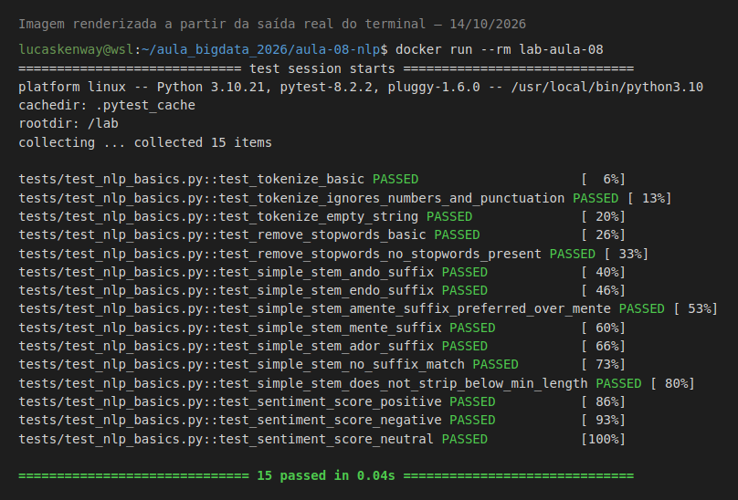

# Evidências — Lab Aula 08 (NLP com Big Data)

- **Nome:** Weslley Lucas Souza Alves
- **RA:** 6325226
- **Branch:** aula-08-6325226
- **Data:** 14/10/2026

## Testes no Docker

```bash
cd aula-08-nlp
docker build -t lab-aula-08 .
docker run --rm lab-aula-08
```

Saída:
```text
============================= test session starts ==============================
platform linux -- Python 3.10.21, pytest-8.2.2, pluggy-1.6.0 -- /usr/local/bin/python3.10
cachedir: .pytest_cache
rootdir: /lab
collecting ... collected 15 items

tests/test_nlp_basics.py::test_tokenize_basic PASSED                     [  6%]
tests/test_nlp_basics.py::test_tokenize_ignores_numbers_and_punctuation PASSED [ 13%]
tests/test_nlp_basics.py::test_tokenize_empty_string PASSED              [ 20%]
tests/test_nlp_basics.py::test_remove_stopwords_basic PASSED             [ 26%]
tests/test_nlp_basics.py::test_remove_stopwords_no_stopwords_present PASSED [ 33%]
tests/test_nlp_basics.py::test_simple_stem_ando_suffix PASSED            [ 40%]
tests/test_nlp_basics.py::test_simple_stem_endo_suffix PASSED            [ 46%]
tests/test_nlp_basics.py::test_simple_stem_amente_suffix_preferred_over_mente PASSED [ 53%]
tests/test_nlp_basics.py::test_simple_stem_mente_suffix PASSED           [ 60%]
tests/test_nlp_basics.py::test_simple_stem_ador_suffix PASSED            [ 66%]
tests/test_nlp_basics.py::test_simple_stem_no_suffix_match PASSED        [ 73%]
tests/test_nlp_basics.py::test_simple_stem_does_not_strip_below_min_length PASSED [ 80%]
tests/test_nlp_basics.py::test_sentiment_score_positive PASSED           [ 86%]
tests/test_nlp_basics.py::test_sentiment_score_negative PASSED           [ 93%]
tests/test_nlp_basics.py::test_sentiment_score_neutral PASSED            [100%]

============================== 15 passed in 0.04s ==============================
```

Print (renderizado com Playwright a partir da saída real acima):

