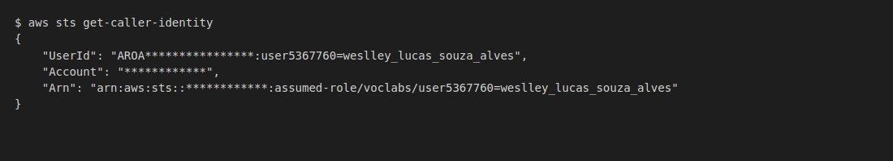
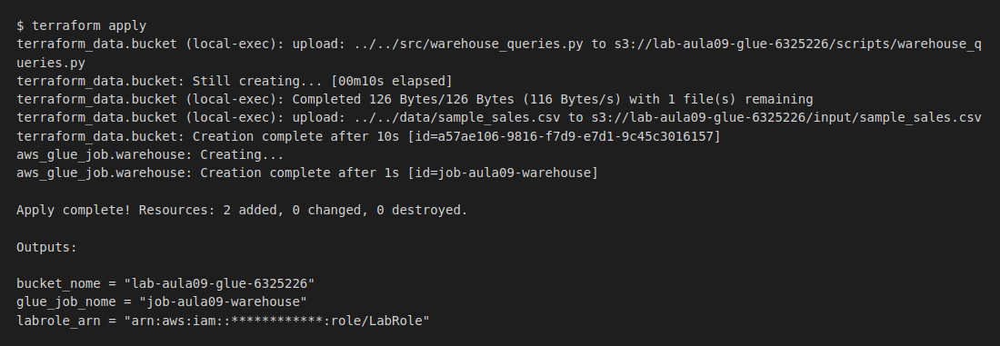
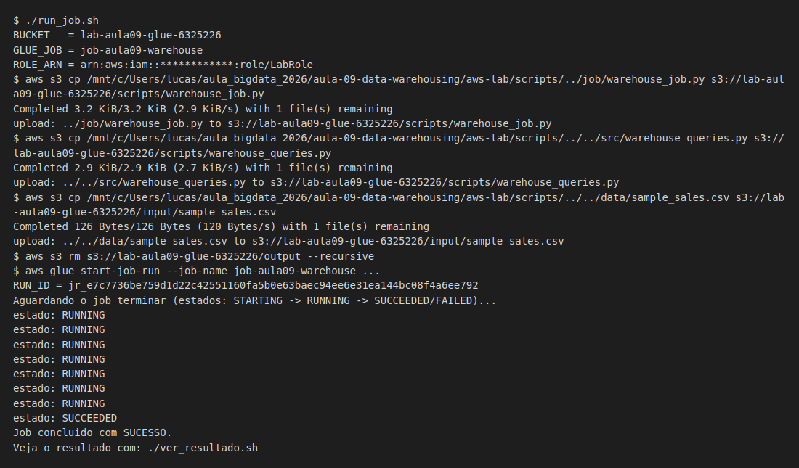
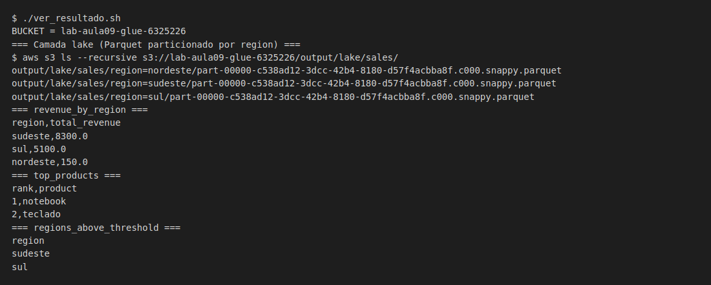
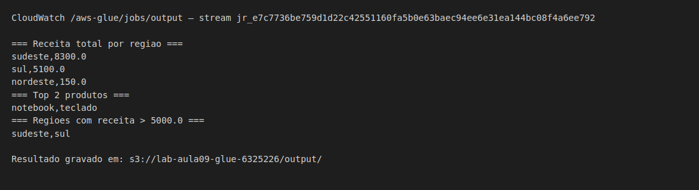
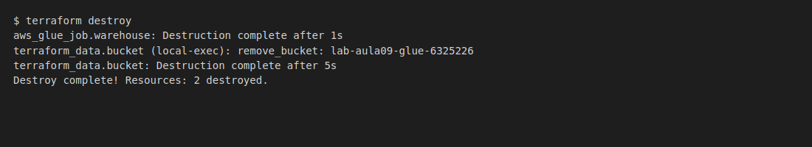

# Evidências — Aula 09 (Data Warehousing com Spark SQL na AWS Glue)

- **Nome:** Weslley Lucas Souza Alves
- **RA:** 6325226
- **Branch:** aula-09-6325226
- **Data:** 26/10/2026

Os prints foram renderizados com Playwright a partir da saída real de cada
comando. `Account`/`UserId` estão mascarados.

---

## 1. Identidade AWS ativa

```text
$ aws sts get-caller-identity
{
    "UserId": "AROA****************:user5367760=weslley_lucas_souza_alves",
    "Account": "************",
    "Arn": "arn:aws:sts::************:assumed-role/voclabs/user5367760=weslley_lucas_souza_alves"
}
```



---

## 2. `terraform apply` concluído

```text
terraform_data.bucket (local-exec): upload: ../../data/sample_sales.csv to s3://lab-aula09-glue-6325226/input/sample_sales.csv
terraform_data.bucket: Creation complete after 10s [id=a57ae106-9816-f7d9-e7d1-9c45c3016157]
aws_glue_job.warehouse: Creating...
aws_glue_job.warehouse: Creation complete after 1s [id=job-aula09-warehouse]

Apply complete! Resources: 2 added, 0 changed, 0 destroyed.

Outputs:

bucket_nome = "lab-aula09-glue-6325226"
glue_job_nome = "job-aula09-warehouse"
labrole_arn = "arn:aws:iam::************:role/LabRole"
```



---

## 3. Job com estado SUCCEEDED (Glue)

```text
$ aws glue start-job-run --job-name job-aula09-warehouse ...
RUN_ID = jr_e7c7736be759d1d22c42551160fa5b0e63baec94ee6e31ea144bc08f4a6ee792
Aguardando o job terminar (estados: STARTING -> RUNNING -> SUCCEEDED/FAILED)...
estado: RUNNING
...
estado: SUCCEEDED
Job concluido com SUCESSO.
```



---

## 4. Resultado (lake particionado + 3 queries)

```text
=== Camada lake (Parquet particionado por region) ===
output/lake/sales/region=nordeste/part-00000-c538ad12-3dcc-42b4-8180-d57f4acbba8f.c000.snappy.parquet
output/lake/sales/region=sudeste/part-00000-c538ad12-3dcc-42b4-8180-d57f4acbba8f.c000.snappy.parquet
output/lake/sales/region=sul/part-00000-c538ad12-3dcc-42b4-8180-d57f4acbba8f.c000.snappy.parquet
=== revenue_by_region ===
region,total_revenue
sudeste,8300.0
sul,5100.0
nordeste,150.0
=== top_products ===
rank,product
1,notebook
2,teclado
=== regions_above_threshold ===
region
sudeste
sul
```



**Interpretação:** o job gravou a camada curated em Parquet particionado por
`region` (uma pasta `region=<valor>` por partição, o mesmo layout de uma tabela
Hive particionada no HDFS) e rodou as três queries do TF sobre ela. O `GROUP BY`
mostra o Sudeste liderando com 8300.0 de receita, o `LIMIT 2` traz `notebook` e
`teclado` como os produtos mais vendidos, e o `HAVING SUM(revenue) > 5000`
filtra só Sudeste e Sul, já que o filtro é aplicado depois da agregação.

---

## 5. Logs do driver (CloudWatch)

Stream `jr_e7c7736be759d1d22c42551160fa5b0e63baec94ee6e31ea144bc08f4a6ee792`
do grupo `/aws-glue/jobs/output`:

```text
=== Receita total por regiao ===
sudeste,8300.0
sul,5100.0
nordeste,150.0
=== Top 2 produtos ===
notebook,teclado
=== Regioes com receita > 5000.0 ===
sudeste,sul
Resultado gravado em: s3://lab-aula09-glue-6325226/output/
```



---

## 6. Limpeza (`terraform destroy`)

```text
aws_glue_job.warehouse: Destruction complete after 1s
terraform_data.bucket (local-exec): remove_bucket: lab-aula09-glue-6325226
terraform_data.bucket: Destruction complete after 5s
Destroy complete! Resources: 2 destroyed.
```


