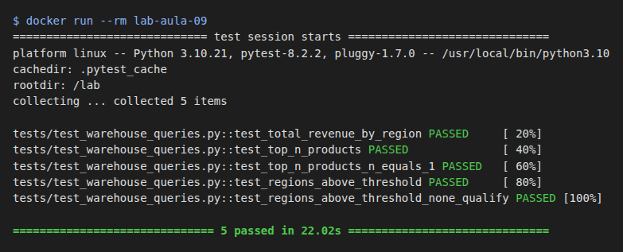

# Evidências — Lab Aula 09 (Data Warehousing e Data Lakes)

- **Nome:** Weslley Lucas Souza Alves
- **RA:** 6325226
- **Branch:** aula-09-6325226
- **Data:** 24/10/2026

## Testes no Docker

```bash
cd aula-09-data-warehousing
docker build -t lab-aula-09 .
docker run --rm lab-aula-09
```

Saída:
```text
============================= test session starts ==============================
platform linux -- Python 3.10.21, pytest-8.2.2, pluggy-1.7.0 -- /usr/local/bin/python3.10
cachedir: .pytest_cache
rootdir: /lab
collecting ... collected 5 items

tests/test_warehouse_queries.py::test_total_revenue_by_region PASSED     [ 20%]
tests/test_warehouse_queries.py::test_top_n_products PASSED              [ 40%]
tests/test_warehouse_queries.py::test_top_n_products_n_equals_1 PASSED   [ 60%]
tests/test_warehouse_queries.py::test_regions_above_threshold PASSED     [ 80%]
tests/test_warehouse_queries.py::test_regions_above_threshold_none_qualify PASSED [100%]

============================== 5 passed in 22.02s ==============================
```

Print (renderizado com Playwright a partir da saída real acima):

