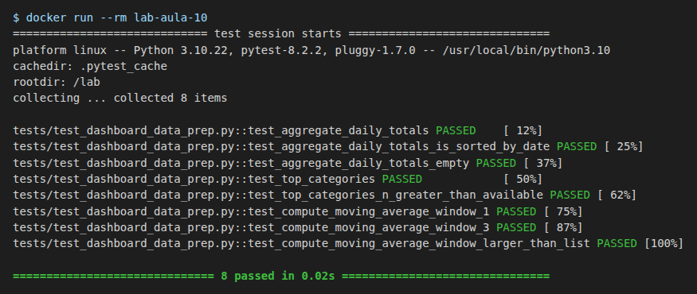

# Evidências — Lab Aula 10 (Visualização de Dados em Larga Escala)

- **Nome:** Weslley Lucas Souza Alves
- **RA:** 6325226
- **Branch:** aula-10-6325226
- **Data:** 30/10/2026

## Testes no Docker

```bash
cd aula-10-visualizacao
docker build -t lab-aula-10 .
docker run --rm lab-aula-10
```

Saída:
```text
============================= test session starts ==============================
platform linux -- Python 3.10.22, pytest-8.2.2, pluggy-1.7.0 -- /usr/local/bin/python3.10
cachedir: .pytest_cache
rootdir: /lab
collecting ... collected 8 items

tests/test_dashboard_data_prep.py::test_aggregate_daily_totals PASSED    [ 12%]
tests/test_dashboard_data_prep.py::test_aggregate_daily_totals_is_sorted_by_date PASSED [ 25%]
tests/test_dashboard_data_prep.py::test_aggregate_daily_totals_empty PASSED [ 37%]
tests/test_dashboard_data_prep.py::test_top_categories PASSED            [ 50%]
tests/test_dashboard_data_prep.py::test_top_categories_n_greater_than_available PASSED [ 62%]
tests/test_dashboard_data_prep.py::test_compute_moving_average_window_1 PASSED [ 75%]
tests/test_dashboard_data_prep.py::test_compute_moving_average_window_3 PASSED [ 87%]
tests/test_dashboard_data_prep.py::test_compute_moving_average_window_larger_than_list PASSED [100%]

============================== 8 passed in 0.02s ===============================
```

Print (renderizado com Playwright a partir da saída real acima):

