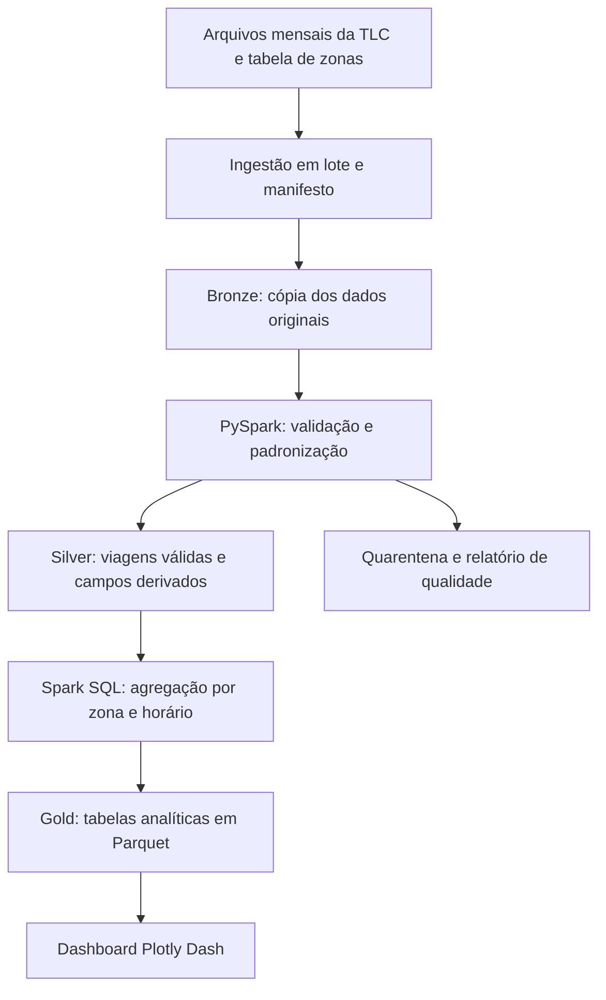

# Projeto de Big Data: análise de demanda de táxis em Nova York

## Project Charter — definição e planejamento

**Disciplina:** Big Data
**Aluno(s):** Guilherme Alvisi, Marcos Eduardo
**Professor(a):** Gustavo Tavares
*RA*: 6325197 - 6325127

## 1. Resumo do projeto

O projeto propõe construir um pipeline de Big Data para analisar viagens de táxis amarelos de Nova York e identificar padrões de embarques por região e horário. A base será o conjunto público NYC TLC Trip Record Data. O produto mínimo viável reunirá ingestão em lote, tratamento com PySpark, análises agregadas e um painel interativo.

A aplicação de negócio será o apoio ao planejamento de posicionamento de uma frota hipotética. Os registros permitem observar viagens realizadas, mas não passageiros que desistiram ou pedidos sem atendimento. Por isso, o projeto usará embarques registrados como indicador de demanda atendida, sem afirmar que representam toda a demanda da cidade.

Este documento apresenta uma proposta de execução. As metas são critérios planejados, e não resultados já obtidos. O processamento da base e a construção do painel pertencem às etapas seguintes.

## 2. Problema de negócio

Uma operadora hipotética precisa escolher em quais regiões e faixas de horário concentrar seus veículos. Decisões sem análise histórica podem posicionar a frota em locais com poucos embarques e dificultar o atendimento nas regiões mais movimentadas.

O problema analítico será identificar como o número de embarques varia entre zonas, horas e dias da semana. A análise entregará evidências para planejar a distribuição da frota, mas não medirá diretamente tempo ocioso, disponibilidade de veículos ou redução de custos, pois esses dados não integram o recorte escolhido.

**Público interessado:** gestores de operação e analistas de mobilidade de uma operadora de táxis hipotética.

## 3. Objetivos

### Objetivo geral

Desenvolver um MVP de análise de dados de viagens que identifique padrões de demanda atendida por zona e horário e disponibilize os resultados em um dashboard.

### Objetivos específicos

- Organizar os arquivos mensais de 2024 em uma camada bruta rastreável.
- Padronizar tipos, validar campos e registrar problemas de qualidade.
- Calcular embarques, duração e distância das viagens por recortes temporais e geográficos.
- Comparar padrões entre dias úteis e finais de semana.
- Entregar um painel com filtros e registrar o desempenho do processamento.

### Perguntas de pesquisa

1. Quais zonas concentram mais embarques no período analisado?
2. Em quais horas e dias da semana cada zona apresenta maior movimento?
3. Como os padrões mudam entre dias úteis e finais de semana?
4. Quais zonas apresentam maior variação mensal de embarques?
5. Qual é a proporção de registros com problemas que afetam essas análises?

## 4. Fonte e recorte dos dados

A fonte principal será a NYC Taxi and Limousine Commission, com arquivos públicos de viagens de táxis amarelos. A fonte complementar será a tabela oficial de zonas para associar códigos a nomes de regiões. A página oficial disponibiliza arquivos mensais em Parquet e a tabela de zonas em CSV [1].

| Item | Definição do projeto |
|---|---|
| Período | Janeiro a dezembro de 2024 |
| Unidade de observação | Uma viagem registrada |
| Recorte inicial | Janeiro de 2024 para validar o pipeline |
| Recorte final | Os 12 arquivos mensais de 2024 |
| Armazenamento bruto | Parquet original e CSV de zonas |
| Atualização do projeto | Carga histórica em lote, sem tempo real |
| Volume | Hipótese de planejamento: milhões de registros e ordem de grandeza de GB no conjunto anual. Medir bytes e linhas na ingestão antes de confirmar |
| Acesso | Download pelos links da página oficial |

O projeto preservará a atribuição à TLC e registrará a data de acesso e os termos aplicáveis à reutilização antes de redistribuir dados. A disponibilidade para download não será tratada como confirmação de uma licença específica. A TLC também informa limitações de precisão e completude [1].

### Campos utilizados

O dicionário oficial descreve os campos de horários, zonas, distância e cobrança [2]. O esquema efetivo dos arquivos de 2024 deverá ser conferido na ingestão.

| Campo | Uso planejado |
|---|---|
| `tpep_pickup_datetime` | Data, hora e agrupamentos de embarque |
| `tpep_dropoff_datetime` | Cálculo da duração |
| `PULocationID` | Zona de origem e chave de integração |
| `DOLocationID` | Zona de destino para exploração complementar |
| `trip_distance` | Distância da viagem, em milhas |
| `total_amount` | Valor cobrado para exploração complementar, sem interpretar como lucro |

O modelo derivado terá `data_embarque`, `hora`, `dia_semana`, `mes`, `zona_origem` e `duracao_minutos`. O relatório registrará como trata horários locais e transições de horário de verão para evitar interpretações incorretas de duração.

## 5. Justificativa de Big Data e os 5 Vs

| Dimensão | Aplicação e limite |
|---|---|
| Volume | Histórico anual de viagens para exercitar leitura particionada e processamento paralelo. O relatório medirá o volume real |
| Velocidade | Cargas mensais. Não há necessidade de streaming no MVP |
| Variedade | Integração de registros transacionais com uma dimensão geográfica, com variedade limitada de formatos |
| Veracidade | Verificações de datas, zonas, valores ausentes e duração |
| Valor | Apoio à escolha de zonas e horários para planejamento operacional |

Volume e processamento histórico são as justificativas principais. O recorte pode caber em uma máquina e não exige, por si só, um cluster. O uso de Spark tem finalidade acadêmica e permite ampliar o histórico sem redesenhar o pipeline. A avaliação técnica deverá registrar se o custo de inicialização do Spark compensa no ambiente utilizado.

## 6. Escopo do MVP

**Incluído:** ingestão dos 12 meses, catálogo dos arquivos, relatório de qualidade, tratamento com PySpark, tabelas agregadas e dashboard com filtros por período e zona.

**Fora do escopo:** despacho automático de veículos, rastreamento em tempo real, aplicativo de passageiros, otimização de rotas e comprovação de aumento de receita.

O MVP será descritivo. A apresentação permite análise agregada como entregável da etapa de análise. Um modelo de previsão será uma extensão opcional, condicionada ao prazo e à qualidade do histórico.

## 7. Arquitetura tecnológica

### Fluxo dos dados

### Escolha das ferramentas

| Componente | Ferramenta | Justificativa |
|---|---|---|
| Ingestão | Python e download em lote | Fonte histórica organizada por mês |
| Armazenamento | Diretórios locais em Parquet | Execução acadêmica simples, com camadas separadas |
| Processamento | PySpark DataFrames e Spark SQL | Tratamento e agregações com o mesmo motor |
| Visualização | Plotly Dash | Painel com filtros sobre tabelas já agregadas |
| Controle do projeto | Git e README | Rastreabilidade do código e instruções de execução |

Kafka não integra o MVP porque a fonte é histórica e mensal. Um banco NoSQL também não é necessário para as consultas agregadas planejadas. Em uma evolução, o armazenamento poderá migrar para S3 ou serviço compatível e o Spark poderá executar em cluster.

O ambiente inicial sugerido é uma máquina com 16 GB de RAM e espaço livre de 20 GB, como hipótese de trabalho a validar após medir os arquivos. Se necessário, o grupo executará a ingestão e as transformações mês a mês. O painel lerá a camada Gold, evitando carregar as viagens brutas na memória.

## 8. Ingestão, qualidade e tratamento

1. Criar um manifesto com URL, mês, tamanho, status e data da carga.
2. Conferir se todos os arquivos abrem e comparar seus esquemas.
3. Preservar o original na camada Bronze e registrar a origem de cada linha.
4. Padronizar tipos e derivar campos temporais.
5. Separar registros com horário obrigatório ausente, embarque fora do período ou desembarque anterior ao embarque.
6. Integrar a tabela de zonas. Manter zonas desconhecidas identificadas e excluí-las somente das análises que exigem localização válida.
7. Sinalizar distâncias ou valores negativos e analisar sua natureza antes de excluir registros de todas as métricas.
8. Publicar a camada Silver e gerar os agregados Gold.

Não se eliminarão automaticamente linhas idênticas entre arquivos sem avaliar a origem: o conjunto não fornece uma chave de viagem definida neste projeto, e duas viagens podem compartilhar atributos. Para impedir duplicação por reexecução, cada partição mensal será substituída de forma controlada, em vez de receber a mesma carga novamente.

O relatório de qualidade informará contagem de entrada, registros válidos, quarentena e motivos. Cada linha receberá um status principal para reconciliar os totais, além de sinalizadores adicionais. A proposta fixa a meta de 100% dos registros classificados, sem definir antecipadamente um percentual artificial de dados válidos.

## 9. Análises e dashboard

### Indicadores

- Total de embarques válidos no filtro selecionado.
- Média de embarques por zona e hora, dividida pela quantidade de dias observados no recorte.
- Participação de cada zona nos embarques válidos com localização conhecida.
- Mediana da duração e da distância entre viagens que passam nas validações correspondentes.
- Percentual de registros em quarentena e incidência de cada problema de qualidade.

As agregações incluirão combinações de zona e hora sem viagens, com valor zero quando houver cobertura do período. Isso evita calcular médias somente sobre horários movimentados. Períodos incompletos receberão indicação de cobertura.

### Composição do painel

| Elemento | Finalidade |
|---|---|
| Filtros de mês, zona e tipo de dia | Explorar o recorte de interesse |
| Série diária de embarques | Observar variação ao longo do tempo |
| Mapa de calor de hora e dia da semana | Localizar picos recorrentes |
| Ranking de zonas | Comparar concentração de embarques |
| Tabela de qualidade | Mostrar cobertura, exclusões e limitações |

Os resultados finais poderão apoiar recomendações de posicionamento para uma frota hipotética. Nenhuma região será apresentada como a mais movimentada antes da análise dos dados.

## 10. Métricas e critérios de aceite

| Critério | Meta planejada | Evidência |
|---|---|---|
| Cobertura | Carregar 12 de 12 meses de 2024 | Manifesto de ingestão |
| Rastreabilidade | Identificar arquivo de origem de todos os registros | Coluna de origem e relatório |
| Reconciliação | Entrada igual à soma de válidos e quarentena | Contagens por mês |
| Consistência | Totais do painel iguais aos agregados publicados | Conferência de recortes conhecidos |
| Idempotência | Reexecutar um mês sem duplicar seus totais | Comparação antes e depois |
| Usabilidade | Filtros atualizarem corretamente as visualizações | Roteiro de verificação |
| Desempenho | Meta inicial de até 3 segundos em 95% de 20 consultas do painel, após carga inicial | Tempos e configuração do ambiente |

O grupo medirá duração total do processamento e registros por segundo, sem prometer um resultado antes de conhecer o hardware e o volume. Como não haverá classificador no MVP, acurácia e F1 não se aplicam.

Caso haja extensão de previsão, o alvo será a contagem de embarques por zona e hora. O grupo fará separação cronológica de treino e teste, usará somente informações disponíveis no momento da previsão e comparará MAE com uma referência sazonal da mesma hora da semana anterior.

## 11. Cronograma conforme as aulas

| Marco | Atividades | Entregável | Dependência |
|---|---|---|---|
| Aula 11 | Validar tema, objetivos, fontes e arquitetura | Project Charter e pitch | Aprovação do escopo |
| Aula 12 | Testar janeiro, medir volume e carregar os demais meses | Bronze, manifesto e primeira versão do relatório de qualidade | Acesso aos arquivos e ambiente |
| Aula 13 | Concluir tratamento e calcular indicadores | Silver, Gold e análises preliminares | Ingestão validada |
| Aula 14 | Construir painel, conferir indicadores e apresentar | Dashboard, documentação e apresentação final | Agregados consistentes |

Estimativa inicial de esforço: 24 horas-pessoa, distribuídas em 4 horas de planejamento, 6 de ingestão, 7 de tratamento e análise, e 7 de visualização e entrega. Essa estimativa deverá ser revista após o teste de janeiro. As datas serão preenchidas conforme o calendário da turma.

## 12. Equipe e responsabilidades

| Papel | Responsabilidade | Integrante |
|---|---|---|
| Engenharia de dados | Ingestão, armazenamento e execução do pipeline | [preencher] |
| Análise de dados | Qualidade, indicadores e interpretação | [preencher] |
| BI e documentação | Dashboard, README e apresentação | [preencher] |

Em trabalho individual, o mesmo aluno assumirá os três papéis. A revisão dos totais e das conclusões será responsabilidade de toda a equipe.

## 13. Riscos e respostas

| Risco | Impacto | Resposta planejada |
|---|---|---|
| Memória ou disco insuficiente | Interrupção de processamento | Medir janeiro, processar por mês e limitar colunas |
| Esquemas divergentes | Falha na união de arquivos | Conferir esquema e aplicar conversões explícitas |
| Datas e zonas inconsistentes | Indicadores incorretos | Quarentena e relatório por regra |
| Interpretação indevida de demanda | Recomendações exageradas | Apresentar embarques como demanda atendida |
| Atraso na execução | Entrega incompleta | Priorizar análise descritiva e adiar previsão |
| Painel lento | Dificuldade de uso | Consultar somente tabelas agregadas |

## 14. Entregáveis finais

1. Project Charter com tema, objetivos, recorte e arquitetura.
2. Pipeline reproduzível de ingestão e transformação.
3. Manifesto dos arquivos e relatório de qualidade.
4. Tabelas analíticas e dashboard interativo.
5. README com ambiente, execução e limitações.
6. Apresentação dos resultados efetivamente encontrados.

O sucesso acadêmico será a entrega de um fluxo completo e verificável, acompanhado de interpretação coerente. Eventuais ganhos financeiros ou operacionais exigirão avaliação posterior com dados da operação de uma frota real.

## 15. Pitch para validação do projeto

“Nosso projeto analisará viagens de táxis amarelos de Nova York para identificar quais regiões e horários concentram mais embarques. Usaremos os arquivos públicos de 2024 da TLC e construiremos um pipeline em lote com PySpark. O fluxo incluirá preservação dos dados originais, validação de qualidade, agregações por zona e horário e um dashboard com filtros. O objetivo é apoiar o planejamento de uma frota hipotética. Vamos avaliar a cobertura dos meses, a consistência dos indicadores e o desempenho do painel. Os dados representam viagens realizadas, então as conclusões se limitarão à demanda atendida. O MVP será descritivo, com previsão como extensão caso o prazo permita.”

## 16. Correspondência com a aula

| Elemento apresentado no material | Seção deste projeto |
|---|---|
| Título, integrantes e papéis | Capa e seção 12 |
| Problema, objetivos e perguntas | Seções 2 e 3 |
| Fonte, formato, volume e esquema | Seção 4 |
| Viabilidade e 5 Vs | Seções 4 e 5 |
| Pipeline e arquitetura | Seções 7 e 8 |
| MVP e métricas | Seções 6, 9 e 10 |
| Cronograma A12, A13 e A14 | Seção 11 |
| Riscos e entregáveis | Seções 13 e 14 |
| Pitch e feedback | Seção 15 |

## 17. Referências

- Material da disciplina: Aula 11 — Definição e Planejamento do Projeto de Big Data, fornecido pelo aluno. Base para a estrutura do planejamento.
- [1] NYC Taxi and Limousine Commission. [TLC Trip Record Data](https://www.nyc.gov/site/tlc/about/tlc-trip-record-data.page). Página oficial dos arquivos e da tabela de zonas. Consulta em 4 de novembro de 2026.
- [2] NYC Taxi and Limousine Commission. [Data Dictionary — Yellow Taxi Trip Records](https://www.nyc.gov/assets/tlc/downloads/pdf/data_dictionary_trip_records_yellow.pdf). Referência dos campos. Conferir compatibilidade com os arquivos históricos de 2024 durante a ingestão. Consulta em 4 de novembro de 2026.
