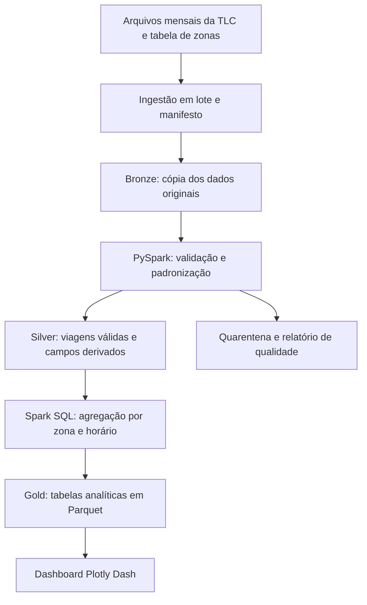

# Proposta de Projeto de Big Data

**Título:** Análise de demanda de táxis em Nova York

Proposta de planejamento da Aula 11. O processamento dos dados e o dashboard serão desenvolvidos nas Aulas 12 a 14. O detalhamento da arquitetura, dos critérios de aceite, dos riscos e do pitch está em [Planejamento completo](PLANEJAMENTO_COMPLETO.md).

## Integrantes do Grupo

- Guilherme Alvisi
- Marcos Eduardo

**RAs informados:** 6325197 e 6325127.

**Professor:** Gustavo Tavares.

Os papéis previstos são engenharia de dados, análise de dados e BI/documentação. Em trabalho individual, o aluno assumirá todos os papéis.

## Problema

Uma operadora hipotética precisa escolher em quais regiões e faixas de horário concentrar seus veículos. Decisões sem análise histórica podem posicionar a frota em locais com poucos embarques e dificultar o atendimento nas regiões mais movimentadas.

O problema analítico será identificar como o número de embarques varia entre zonas, horas e dias da semana. A análise entregará evidências para planejar a distribuição da frota, mas não medirá diretamente tempo ocioso, disponibilidade de veículos ou redução de custos, pois esses dados não integram o recorte escolhido.

**Público interessado:** gestores de operação e analistas de mobilidade de uma operadora de táxis hipotética.

## Objetivos

### Objetivo geral

Desenvolver um MVP de análise de dados de viagens que identifique padrões de demanda atendida por zona e horário e disponibilize os resultados em um dashboard.

### Objetivos específicos

- Organizar os arquivos mensais de 2024 em uma camada bruta rastreável.
- Padronizar tipos, validar campos e registrar problemas de qualidade.
- Calcular embarques, duração e distância das viagens por recortes temporais e geográficos.
- Comparar padrões entre dias úteis e finais de semana.
- Entregar um painel com filtros e registrar o desempenho do processamento.

### Perguntas de pesquisa

1. Quais zonas concentram mais embarques no período analisado?
2. Em quais horas e dias da semana cada zona apresenta maior movimento?
3. Como os padrões mudam entre dias úteis e finais de semana?
4. Quais zonas apresentam maior variação mensal de embarques?
5. Qual é a proporção de registros com problemas que afetam essas análises?

## Dataset(s) e Fonte

A fonte principal será a NYC Taxi and Limousine Commission, com arquivos públicos de viagens de táxis amarelos. A fonte complementar será a tabela oficial de zonas para associar códigos a nomes de regiões. A página oficial disponibiliza arquivos mensais em Parquet e a tabela de zonas em CSV [1].

| Item | Definição do projeto |
|---|---|
| Período | Janeiro a dezembro de 2024 |
| Unidade de observação | Uma viagem registrada |
| Recorte inicial | Janeiro de 2024 para validar o pipeline |
| Recorte final | Os 12 arquivos mensais de 2024 |
| Armazenamento bruto | Parquet original e CSV de zonas |
| Atualização do projeto | Carga histórica em lote, sem tempo real |
| Volume | Hipótese de planejamento: milhões de registros e ordem de grandeza de GB no conjunto anual. Medir bytes e linhas na ingestão antes de confirmar |
| Acesso | Download pelos links da página oficial |

O projeto preservará a atribuição à TLC e registrará a data de acesso e os termos aplicáveis à reutilização antes de redistribuir dados. A disponibilidade para download não será tratada como confirmação de uma licença específica. A TLC também informa limitações de precisão e completude [1].

### Campos utilizados

O dicionário oficial descreve os campos de horários, zonas, distância e cobrança [2]. O esquema efetivo dos arquivos de 2024 deverá ser conferido na ingestão.

| Campo | Uso planejado |
|---|---|
| `tpep_pickup_datetime` | Data, hora e agrupamentos de embarque |
| `tpep_dropoff_datetime` | Cálculo da duração |
| `PULocationID` | Zona de origem e chave de integração |
| `DOLocationID` | Zona de destino para exploração complementar |
| `trip_distance` | Distância da viagem, em milhas |
| `total_amount` | Valor cobrado para exploração complementar, sem interpretar como lucro |

O modelo derivado terá `data_embarque`, `hora`, `dia_semana`, `mes`, `zona_origem` e `duracao_minutos`. O relatório registrará como trata horários locais e transições de horário de verão para evitar interpretações incorretas de duração.

| Dimensão | Aplicação e limite |
|---|---|
| Volume | Histórico anual de viagens para exercitar leitura particionada e processamento paralelo. O relatório medirá o volume real |
| Velocidade | Cargas mensais. Não há necessidade de streaming no MVP |
| Variedade | Integração de registros transacionais com uma dimensão geográfica, com variedade limitada de formatos |
| Veracidade | Verificações de datas, zonas, valores ausentes e duração |
| Valor | Apoio à escolha de zonas e horários para planejamento operacional |

Volume e processamento histórico são as justificativas principais. O recorte pode caber em uma máquina e não exige, por si só, um cluster. O uso de Spark tem finalidade acadêmica e permite ampliar o histórico sem redesenhar o pipeline. A avaliação técnica deverá registrar se o custo de inicialização do Spark compensa no ambiente utilizado.

## Ferramentas de Big Data

### Fluxo dos dados

### Escolha das ferramentas

| Componente | Ferramenta | Justificativa |
|---|---|---|
| Ingestão | Python e download em lote | Fonte histórica organizada por mês |
| Armazenamento | Diretórios locais em Parquet | Execução acadêmica simples, com camadas separadas |
| Processamento | PySpark DataFrames e Spark SQL | Tratamento e agregações com o mesmo motor |
| Visualização | Plotly Dash | Painel com filtros sobre tabelas já agregadas |
| Controle do projeto | Git e README | Rastreabilidade do código e instruções de execução |

Kafka não integra o MVP porque a fonte é histórica e mensal. Um banco NoSQL também não é necessário para as consultas agregadas planejadas. Em uma evolução, o armazenamento poderá migrar para S3 ou serviço compatível e o Spark poderá executar em cluster.

O ambiente inicial sugerido é uma máquina com 16 GB de RAM e espaço livre de 20 GB, como hipótese de trabalho a validar após medir os arquivos. Se necessário, o grupo executará a ingestão e as transformações mês a mês. O painel lerá a camada Gold, evitando carregar as viagens brutas na memória.

## Cronograma

| Marco | Atividades | Entregável | Dependência |
|---|---|---|---|
| Aula 11 | Validar tema, objetivos, fontes e arquitetura | Project Charter e pitch | Aprovação do escopo |
| Aula 12 | Testar janeiro, medir volume e carregar os demais meses | Bronze, manifesto e primeira versão do relatório de qualidade | Acesso aos arquivos e ambiente |
| Aula 13 | Concluir tratamento e calcular indicadores | Silver, Gold e análises preliminares | Ingestão validada |
| Aula 14 | Construir painel, conferir indicadores e apresentar | Dashboard, documentação e apresentação final | Agregados consistentes |

Estimativa inicial de esforço: 24 horas-pessoa, distribuídas em 4 horas de planejamento, 6 de ingestão, 7 de tratamento e análise, e 7 de visualização e entrega. Essa estimativa deverá ser revista após o teste de janeiro. As datas serão preenchidas conforme o calendário da turma.

**Referências dos dados:**

- [1] [NYC TLC Trip Record Data](https://www.nyc.gov/site/tlc/about/tlc-trip-record-data.page).
- [2] [Dicionário de dados de táxis amarelos](https://www.nyc.gov/assets/tlc/downloads/pdf/data_dictionary_trip_records_yellow.pdf).
