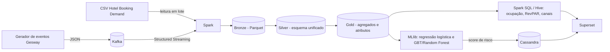

# Proposta de Projeto de Big Data — Previsão de cancelamento de reservas para hotéis de pequeno porte (domínio Gesway)

## Integrantes do Grupo

Grupo Gesway (o mesmo do projeto experimental da UniFAAT):

| Integrante | RA | Papel no charter *(a confirmar pelo grupo)* |
|---|---|---|
| Gabriel Reis Cunha | 6325149 | Engenheiro de Dados — ingestão (Kafka/Spark), camadas do Data Lake, orquestração |
| Sirlande Martins | 6325269 | Cientista de Dados — preparação de atributos, modelos (MLlib) e métricas |
| Weslley Lucas | 6325226 | Analista de BI — consultas Spark SQL/Hive, dashboard Superset e infraestrutura |

Com três integrantes, os papéis se sobrepõem: cada um é responsável por uma fase, mas revisa as demais.

## Problema

**Contexto.** O Gesway é um PMS (sistema de gestão hoteleira) SaaS multi-tenant para pousadas e hotéis pequenos. Ele já publica eventos de domínio (reservas, pagamentos, quartos, hóspedes) e já calcula indicadores como ocupação, ADR e RevPAR sobre o banco transacional.

**Dor de negócio.** Hotel pequeno perde receita com cancelamento e no-show porque não sabe quais reservas vão cair. Sem essa previsão, ele não faz overbooking controlado nem cobra sinal de quem tem maior risco. Hoje o Gesway só sinaliza "reserva confirmada sem pagamento", uma regra simples que não aprende com o histórico.

**Por que Big Data.** Um hotel pequeno gera poucos registros, mas uma plataforma SaaS com centenas de hotéis gera milhões de eventos por ano e precisa de um score de risco atualizado em fluxo contínuo. O volume real do Gesway ainda é pequeno (o seed tem dezenas de reservas), então o projeto usa um dataset público para volume e rótulo, e um gerador de eventos sintéticos, no formato do catálogo do Gesway, para volume e velocidade (ver seção de dados).

**Perguntas de pesquisa.**
1. Quais fatores mais aumentam o risco de cancelamento de uma reserva?
2. É possível prever o cancelamento com F1 ≥ 0,70?
3. Como evoluem a ocupação e o RevPAR por mês e por canal?

## Objetivos

**Objetivo geral.** Construir um MVP de pipeline de Big Data, da ingestão ao dashboard, que estime o risco de cancelamento de cada reserva e mostre indicadores de ocupação e receita. É um MVP acadêmico, não um módulo de produção do Gesway.

**Objetivos específicos e métricas de sucesso.**

| # | Objetivo | Métrica | Meta |
|---|---|---|---|
| O1 | Ingerir eventos no formato Gesway via Kafka e o CSV público em lote | Throughput de ingestão | ≥ 5.000 eventos/s em ambiente local *(a validar)* |
| O2 | Organizar o Data Lake em camadas bronze, silver e gold (Parquet) | Esquemas unificados entre fontes | 100% das colunas mapeadas na silver |
| O3 | Treinar baseline (regressão logística) e modelo principal (GBT ou Random Forest) | F1 da classe "cancelada" no conjunto de teste | ≥ 0,70 (alvo; baseline serve de comparação) |
| O4 | Avaliar o modelo | AUC-ROC e matriz de confusão | AUC ≥ 0,80 *(a validar)* |
| O5 | Responder à pergunta 1 | Importância das variáveis do modelo | Top 10 variáveis documentadas |
| O6 | Entregar o dashboard (ocupação, RevPAR, risco de cancelamento) | Latência de consulta no dashboard | ≤ 5 s por gráfico sobre a camada gold |

As metas de F1, AUC e throughput são alvos de planejamento: o grupo ainda não mediu nenhuma delas.

## Dataset(s) e Fonte

### Fontes

| Fonte | Origem | Licença | Formato | Frequência | Volume estimado |
|---|---|---|---|---|---|
| **Hotel Booking Demand** (Antonio, Almeida & Nunes, 2019, *Data in Brief*, vol. 22, pp. 41–49, DOI 10.1016/j.dib.2018.11.126) | Artigo e Kaggle | **A confirmar** na página do Kaggle e do artigo (o repositório do ISCTE-IUL só indica direitos reservados; a licença CC BY 4.0 citada por nós ainda não foi verificada) | CSV | Estático (lote único) | 119.390 reservas (40.060 do hotel resort e 79.330 do hotel de cidade, jul/2015 a ago/2017), ~32 colunas; tamanho em disco **a confirmar** (ordem de dezenas de MB) |
| **Eventos sintéticos no formato Gesway** (gerador próprio) | Script do grupo, seguindo o catálogo de eventos do Gesway (`reservation.created`, `reservation.status_changed`, `payment.created`, `payment.status_changed` etc.) | Dado gerado pelo grupo, sem dado real | JSON (envelope com `event_id`, `type`, `occurred_at`, `tenant_id`, `payload`) → Kafka | Contínua (fluxo simulado) | ~26 milhões de eventos, ~16 GB em JSON (cálculo abaixo) |
| **Avaliações de hóspedes (texto)** | A definir | A definir | — | — | **Fora do MVP.** NLP fica como extensão futura; só entra se houver dataset com licença clara |

### Estimativa de volume dos eventos sintéticos

300 hotéis simulados × 20 reservas/dia = 6.000 reservas/dia. Com ~6 eventos por reserva (criação, mudanças de status, pagamentos) são ~36.000 eventos/dia. Em 730 dias (2 anos): ~26,3 milhões de eventos. Com ~600 bytes por evento em JSON, o total é ~15,8 GB brutos. O Parquet comprimido deve ficar bem abaixo disso (**a medir**).
Para o desenvolvimento local o grupo usa uma amostra (por exemplo, 10%); o volume completo roda apenas na nuvem, se couber nos limites do Learner Lab.

### Esquema resumido

- **Kaggle:** `hotel`, `is_canceled` (rótulo), `lead_time`, `arrival_date_*`, `stays_in_weekend_nights`, `stays_in_week_nights`, `adults`, `children`, `market_segment`, `distribution_channel`, `previous_cancellations`, `deposit_type`, `adr`, `required_car_parking_spaces`, `total_of_special_requests`, `reservation_status`.
- **Eventos Gesway:** envelope + payload de reserva (`status` PENDING/CONFIRMED/CHECKED_IN/CHECKED_OUT/CANCELLED, `check_in_date`, `check_out_date`, `total_amount`, `guest_id`, `room_id`) e de pagamento (`amount`, `method`, `status`, `paid_at`).
- **Mapeamento:** na camada silver, os atributos do Kaggle são traduzidos para o modelo de reserva do Gesway (por exemplo, `adr × noites` → `total_amount`; `is_canceled` → `status = CANCELLED`).

### Validação pelos 5 Vs

| V | Avaliação |
|---|---|
| **Volume** | ~16 GB de eventos sintéticos + 119 mil reservas reais. Volume moderado: justifica Spark e Parquet particionado, mas não é petabyte. |
| **Velocidade** | Eventos publicados continuamente no Kafka e processados em Structured Streaming. |
| **Variedade** | CSV tabular + eventos JSON aninhados. Texto de avaliações é extensão futura. |
| **Veracidade** | O Kaggle é dado real, anonimizado e publicado em artigo científico. Os eventos sintéticos refletem as regras do Gesway, mas não o comportamento real dos hóspedes: o modelo é validado no Kaggle, não nos sintéticos. |
| **Valor** | Prever cancelamento permite overbooking controlado e cobrança de sinal por risco. |

### Qualidade, acesso e privacidade

- **Rótulo:** `is_canceled` está no Kaggle; nos eventos sintéticos o rótulo vem do estado final da reserva.
- **Acesso:** download direto do Kaggle (exige conta gratuita).
- **LGPD:** só dados públicos ou sintéticos. Os eventos gerados não têm nome, telefone nem documento de hóspede; nenhum dado real do Gesway é usado.

## Ferramentas de Big Data

### Fluxo dos dados

O armazenamento é o MinIO (compatível com S3) no ambiente local, e S3 na nuvem.

### Por que cada ferramenta entra

| Ferramenta | Por quê |
|---|---|
| **Apache Kafka** | Reproduz o fluxo contínuo de eventos do Gesway (no produto real o broker é o RabbitMQ; o Kafka entra aqui por ser o broker visto no curso e por suportar volume e reprocessamento). |
| **Spark (DataFrames e Structured Streaming)** | Lê o lote e o fluxo com o mesmo motor, faz a limpeza e escreve as camadas Parquet. |
| **MinIO / S3 + Parquet** | Data Lake barato, colunar e particionável; separa bronze, silver e gold. |
| **Spark SQL / Hive** | Agregados de ocupação, RevPAR e cancelamento por mês e canal na camada gold. |
| **Spark MLlib** | Treina baseline (regressão logística) e modelo principal (GBT ou Random Forest) em Pipeline reprodutível. |
| **Cassandra** | Guarda o score de risco por reserva, com leitura rápida por chave para o dashboard e, no futuro, para o Gesway. |
| **Apache Superset** | Dashboard de ocupação, RevPAR e risco de cancelamento para o gestor do hotel. |

### Infraestrutura

O desenvolvimento roda em Docker local (Kafka, Spark, MinIO, Cassandra e Superset juntos). A nuvem entra na arquitetura-alvo (S3 para o Data Lake e Glue para os jobs Spark, como nos labs anteriores), usando apenas o **AWS Academy Learner Lab**, dentro do free tier, provisionada com Terraform e com **destruição dos recursos logo após cada uso**. Esta proposta é só de planejamento: nada foi provisionado. Nenhuma conta AWS pessoal será usada.

### Matriz de planejamento

| Fase | Tecnologias | Entregável principal | Risco técnico principal |
|---|---|---|---|
| 1. Ingestão | Kafka, Spark, MinIO/S3 | Pipeline de carga e camada bronze | Incompatibilidade de esquema entre Kaggle e Gesway; memória (Kafka + Spark + Superset na mesma máquina) |
| 2. Tratamento | Spark SQL, DataFrames | Camadas silver e gold curadas | Dados faltantes e tipos inconsistentes (por exemplo `children` nulo) |
| 3. Análise / ML | MLlib, Hive, Cassandra | Modelo treinado com F1/AUC e agregados | Desbalanceamento de classes, overfitting, gargalo de memória |
| 4. Visualização | Superset | Painel interativo e apresentação | Lentidão de renderização; volume real do Gesway pequeno (mitigado pelo gerador) |

### Riscos adicionais e mitigação

- **Esquema Kaggle × Gesway:** mapeamento explícito e testado na camada silver.
- **Memória da máquina:** amostra de 10% no desenvolvimento e serviços subidos por etapa.
- **Desbalanceamento:** ponderação de classes e avaliação por F1, não só por acurácia.
- **Sintético não é real:** o resultado do modelo é reportado sobre o Kaggle; os eventos sintéticos validam o pipeline e o throughput.

## Cronograma

As datas das aulas 12 a 14 ainda não foram divulgadas; o plano segue os marcos da disciplina e as datas serão preenchidas quando o calendário sair.

| Marco | Aula | Data | Atividades | Entregável |
|---|---|---|---|---|
| Planejamento | 11 | A divulgar | Proposta, escolha dos dados e da arquitetura | Esta proposta |
| Ingestão e pré-processamento | 12 (A12) | A divulgar | Gerador de eventos, Kafka, leitura do CSV, camadas bronze e silver | Pipeline de carga e dataset curado |
| Análise e modelos | 13 (A13) | A divulgar | Atributos, baseline e modelo principal, agregados Spark SQL/Hive, score no Cassandra | Modelo treinado com F1/AUC |
| Dashboard e apresentação | 14 (A14) | A divulgar | Painel no Superset, medição de latência, relatório final | Dashboard e apresentação |

**Distribuição do esforço (estimativa do grupo):** ingestão e tratamento ~40%, análise e modelos ~30%, visualização ~15%, documentação e apresentação ~15%.

**Escopo.** Está dentro do MVP: pipeline, modelo e dashboard. Fica fora: integração com o produto Gesway, NLP e qualquer uso de dado real de hóspede.
